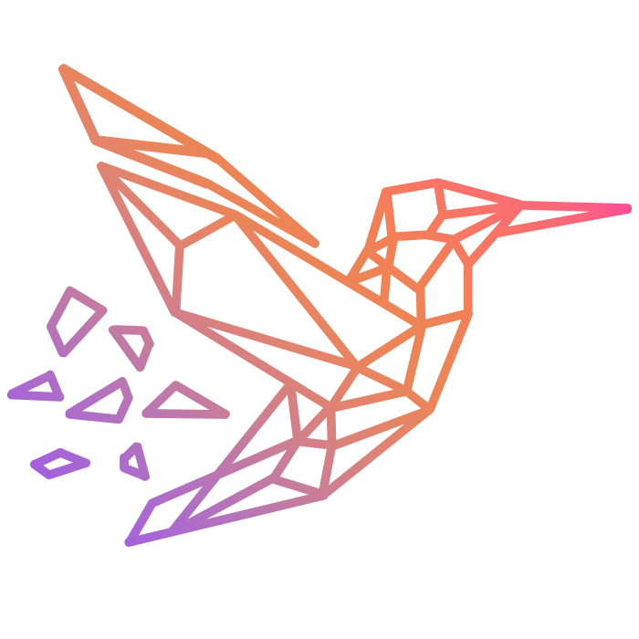
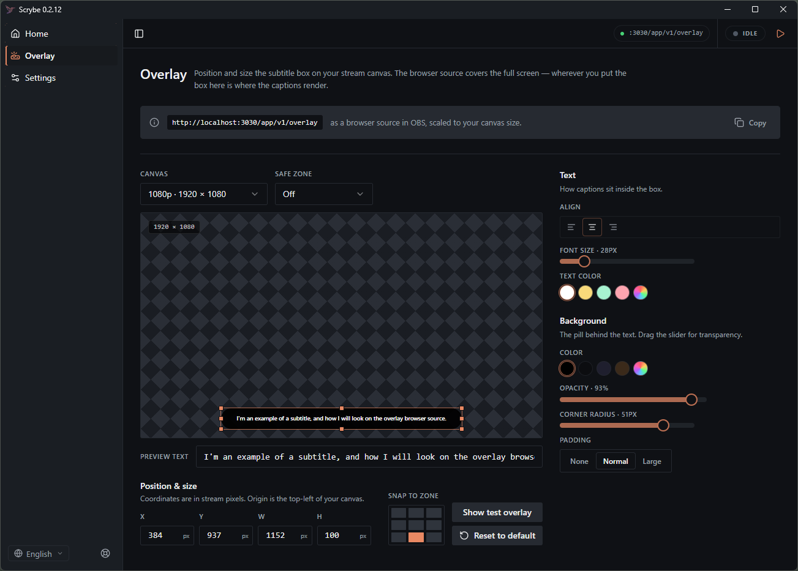

  

# Local Subtitles for your own Broadcasts

Currently most programs available to add subtitles to your own broadcasts require sending your audio to a third-party service. This is a basic attempt at a fully local, livestream-native subtitling program.

  

## Development setup

1. **Initialize submodules.** Run `git submodule update --init --recursive` unless you cloned with `--recurse-submodules`.
2. **Check dependencies.** Run `./utils/scripts/install_deps.sh` (macOS/Linux) or `./utils/scripts/install_deps.ps1` (Windows) to verify every tool the build needs; missing tools are printed with install hints. Pass `--ci` / `-CI` to install them automatically.
3. **Build & run.** `pnpm install && pnpm tauri dev`.

### Make shortcuts

With GNU Make and `toke` available on `PATH`, these optional shortcuts cover common workflows:

| Command                        | Description                                                 |
| ------------------------------ | ----------------------------------------------------------- |
| `make dev`                     | Run the desktop app in development mode.                    |
| `make dev-internal`            | Run with the internal frontend and Rust checkout enabled.   |
| `make build`                   | Build the production desktop application.                   |
| `make build-internal`          | Build with the internal frontend and Rust checkout enabled. |
| `make check`                   | Run frontend and Rust checks.                               |
| `make test`                    | Run the Node and Rust test suites.                          |
| `make validate-transcription`  | Validate transcription against the configured local model.  |
| `make validate-hallucinations` | Validate hallucination filtering with configured models.    |

## Plans

This is still in very early development so it's not really usable as-is. If you're really interested before I finish updating this, you can send me an [email](mailto:scrybe@synth.sh) and I can help you set it up.

Some features planned:

- Multiple audio streams. Meaning you can create independent subtitles for desktop audio and your microphone at the same time.
- Support for Twitch native closed captioning
- OBS plugin to support muting subtitles when you mute your microphone in OBS
- Support subtitle translation
